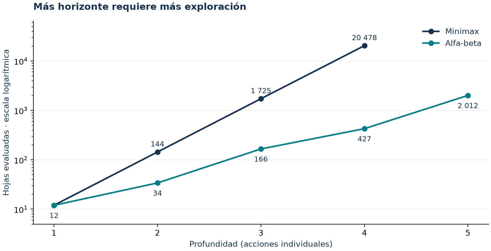
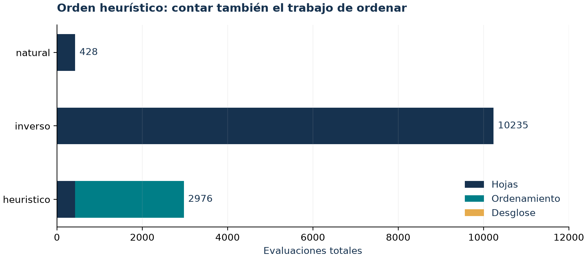

# Documento técnico — TacticalGrid

**Proyecto 1 · Sistemas Inteligentes I · Universidad de Caldas** · Docente: Jairo I. Vélez B.
**Integrantes:** Daniel Quintero Hurtado · Juan David Ocampo González
**Edición de entrega:** 21 de octubre de 2026. Código auditado más tabla comparativa adversarial; el commit que contiene estos documentos identifica la entrega. El tag `v1.0-sustentacion` es histórico y no identifica esta edición.

> Redactado con apoyo de Claude Code y actualizado por Codex tras pruebas de regresión. Juan recorrió los diez casos durante el ensayo y revisó la tabla adversarial; esto no certifica revisión línea por línea ni una nueva revisión de Daniel (ver `docs/USO_IA.md`). Todas las cifras salen de `resultados/RESUMEN.md` y de los CSV E1–E6; se regeneran con `python -m tacticalgrid experimentos`.

---

## 1. Modelado del problema

El juego es el entorno; el sistema inteligente es lo que decide dentro de él. Separamos el software en capas: **escenario** (lectura y validación del JSON), **juego** (estado y reglas), **búsqueda** y **adversarial** (algoritmos), **verificación**, **experimentos** e **interfaz**. Una prueba automática (`tests/test_arquitectura.py`) comprueba que ninguna capa importe a una superior.

Distinguimos lo que **no cambia** durante una partida y lo que **sí cambia**:

| No cambia → `Escenario` (`escenario/modelo.py`) | Cambia → estado |
|---|---|
| dimensiones, matriz de terreno, catálogo de terrenos y costos, bases, posición inicial del recurso, identidad/bando/tipo/posición inicial de cada unidad | posiciones actuales, quién lleva el recurso, dónde está el recurso libre, turno, turnos jugados |

Sobre el mismo escenario modelamos **tres problemas**:

| Problema | Estado | Inicial | Acciones / sucesores | Objetivo | Costo |
|---|---|---|---|---|---|
| Navegación (`ProblemaNavegacion`) | `(fila, columna)` | celda de `prueba.unidad_inicio` | moverse a una celda vecina (4 direcciones) transitable | `prueba.objetivo` | costo del terreno al que se entra |
| Misión (`ProblemaMision`) | `((fila, columna), lleva_recurso)` | celda de la unidad, `lleva` = si ya lo lleva | igual, y `lleva` pasa a `True` al entrar a la celda del recurso | `(base propia, True)` | igual |
| Partida adversarial | `EstadoJuego` (sección 2) | `estado_inicial(escenario)` | `acciones_legales` (sección 3) | alguien entrega el recurso o se llega al límite de turnos | costo del terreno al MOVER, 0 en otro caso |

Los algoritmos de búsqueda no saben que existe un juego: solo usan `problema.inicio`, `problema.es_objetivo(s)` y `problema.sucesores(s) → [(s', costo)]`. Por eso el mismo BFS resuelve la navegación y la misión.

## 2. Representación de estados

```python
@dataclass(frozen=True)
class EstadoJuego:
    posiciones: tuple[tuple[int, int], ...]  # posiciones[i] es la de escenario.unidades[i]
    portador: str | None                      # id de quien lleva el recurso, o None
    recurso: tuple[int, int] | None           # dónde está el recurso si está libre
    turno: str                                # "A" o "B"
    turnos_jugados: int = 0
```

**Por qué es suficiente:** con el escenario más estos cinco campos se calculan las acciones legales, el estado siguiente, si hay ganador y la evaluación. **Por qué cada campo es necesario:**
- `posiciones`: determinan a dónde se puede mover cada unidad y quién bloquea a quién.
- `portador` / `recurso`: la misma posición física puede ser estados distintos. Una unidad sobre su base gana si lleva el recurso y no gana si no lo lleva (caso 6 y `test_estado_compuesto`).
- `turno`: el mismo tablero tiene acciones y valor Minimax distintos según quién juega.
- `turnos_jugados`: el mismo tablero en el turno 10 y en el turno 200 difiere en si la partida terminó (empate).

El estado es **inmutable y hashable** (`frozen=True`, tuplas), así se puede usar en conjuntos y diccionarios de visitados. Invariantes (`reglas.validar_estado`): todas las unidades dentro del mapa y en celdas transitables, sin dos unidades en la misma celda, y el recurso libre o con portador, nunca ambas cosas.

**Caso 6 (estado compuesto):** en `caso06_estado_compuesto.json` la unidad A1 entra a un pasillo sin salida, recoge el recurso al fondo y vuelve por las mismas celdas. Varias celdas del pasillo aparecen dos veces en el camino de la misión: una con `lleva = False` y otra con `lleva = True` (UCS: costo 22, 20 movimientos). Con el estado `(fila, columna)` el segundo paso por una celda se descartaría como "ya visitado" y la misión sería imposible.

## 3. Reglas del juego

Ambos bandos usan exactamente las mismas reglas (`juego/reglas.py`).

| # | Regla |
|---|---|
| R1 | Por turno, el bando en turno elige una unidad propia y una acción; luego cambia el turno y `turnos_jugados` aumenta en 1. |
| R2 | **MOVER** a una celda vecina dentro del mapa, transitable y libre (sin otra unidad). |
| R3 | Ninguna unidad puede entrar a la **base enemiga**. Las bases son una sola celda: sin esta regla, quedarse sobre la base rival impediría ganar para siempre. |
| R4 | Entrar a la celda del recurso libre lo **recoge**. |
| R5 | **INTERCEPTAR**: una unidad al lado del portador enemigo le hace perder el recurso. El recurso vuelve libre a su posición inicial y el antiguo portador vuelve a su posición inicial (si está ocupada, se queda donde está). |
| R6 | Si el portador está en la base de su bando, ese bando **gana**. |
| R7 | Si un bando no tiene ninguna acción, su única acción es **PASAR**. |
| R8 | Al llegar a `max_turnos` (200 por defecto, configurable en el JSON) sin ganador, la partida termina en **empate**. Una entrega válida conserva la victoria incluso en el último turno. |
| R9 | En modo búsqueda, si no se encuentra camino se devuelve `exito = false` con métricas. En Beam puede existir una ruta descartada: fracaso no implica inalcanzabilidad. |
| R10 | Orden determinista: unidades en el orden del JSON; para cada una, primero INTERCEPTAR y luego MOVER en el orden `abajo, arriba, derecha, izquierda` (el de los notebooks), configurable. |

**Historia de R5 (decisión D‑14):**
- **Primera versión:** el interceptor se quedaba con el recurso. Al jugar en un mapa simétrico, dos unidades vecinas se lo quitaban en cada turno: 166 intercepciones en 200 turnos, y toda partida terminaba en empate.
- **Segunda versión:** se agregó que el antiguo portador vuelva a su inicio.
- **Versión final (propuesta de Daniel):** también el recurso vuelve a su sitio. Interceptar es una jugada **defensiva** que reinicia la carrera, y elimina el intercambio inmediato del recurso entre dos unidades. No garantiza ausencia de ciclos; el límite de turnos asegura la terminación. Como consecuencia, el recurso libre siempre está en su posición inicial.

En **modo búsqueda** las demás unidades se ignoran, porque el enunciado dice que en esa etapa se ignora al adversario. Con `prueba.unidades_bloquean: true` se tratan como obstáculos.


### Algoritmos y estructuras auxiliares

| Método | Estructura / prioridad | Garantía en el modelo implementado |
|---|---|---|
| BFS | Cola FIFO, padres como visitados | Mínimos movimientos en el grafo finito; no mínimo costo con terrenos distintos. |
| DFS | Pila LIFO, padres como visitados | Encuentra una ruta si existe en el grafo finito explorado; no garantiza optimalidad. |
| UCS | Heap por g, mejor_g y padres | Mínimo costo con costos positivos; se implementa reutilizando A* con h = 0. |
| A* | Heap por g + h y desempate de inserción | Mínimo costo con H1/H2 consistentes; elimina entradas obsoletas y conserva mejores costos. |
| Beam | Candidatos por nivel, orden h y recorte a k | Incompleto y subóptimo en general; mantiene visitados globales y padres. |
| Minimax / alfa-beta | Recursión, listas de acciones y límites alfa/beta | Mejor valor del árbol limitado; misma decisión si profundidad, utilidad y orden coinciden. |

El orden natural adversarial recorre unidades según JSON y movimientos abajo, arriba, derecha, izquierda, con intercepción primero si corresponde. Inverso revierte la lista completa. Heurístico evalúa hijos inmediatos: mayor primero en MAX y menor primero en MIN. El empate conserva la primera mejor acción. Profundidad cuenta acciones individuales, no rondas completas. Una evaluación a profundidad 1 es el agente de contraste VORAZ; no usa la h de navegación.

## 4. Costos

- **Costo de una acción:** el costo del terreno de la celda a la que se **entra** (`Escenario.costo`). INTERCEPTAR y PASAR cuestan 0.
- **Costo de un camino:** la suma de los costos de las celdas del camino, sin contar la inicial.
- **Origen de los costos:** siempre `tipos_terreno` del JSON. Ningún algoritmo tiene costos escritos en el código; los únicos valores por defecto del proyecto están en `config.py`, y no incluyen costos.
- **Validación:** el validador exige costo > 0 en los terrenos transitables, lo que permite usar UCS. A\* necesita además una heurística admisible; H1 y H2 también son consistentes. H3 no ofrece esa garantía.

**Sensibilidad (E3, caso 2: franja de pantano en línea recta y un corredor de camino alrededor):**

| Costo del pantano | BFS (pasos / costo) | UCS (pasos / costo) | A\* obstáculos (expandidos) |
|---|---|---|---|
| 1 | 17 / 23 | 17 / 23 | 55 |
| 2 | 17 / 33 | 17 / 33 | 156 |
| 3 | 17 / 43 | **33 / 33** | 116 |
| 7 (original) | 17 / 83 | 33 / 33 | 92 |
| 15 | 17 / 163 | 33 / 33 | 85 |
| 20 | 17 / 213 | 33 / 33 | 85 |

**Interpretación:**
- **BFS** nunca cambia de camino, porque no mira costos; su costo crece linealmente con el del pantano.
- **UCS** cambia al rodeo cuando cruzar el pantano deja de convenir. Con costo 2 ambos caminos cuestan 33 y gana el directo por desempate; desde 3, el rodeo.
- **Ejemplo del enunciado (pantano de 7 a 15):** la predicción correcta es que UCS **no cambia** (ya rodeaba), y que BFS sigue igual pero su costo sube de 83 a 163.

## 5. Heurísticas

Sea **c_min** el menor costo entre los terrenos transitables **presentes en el mapa cargado** (se lee del JSON).

### H1 — Manhattan: h₁(n) = c_min · (|f − f_obj| + |c − c_obj|)
- **Qué estima:** el costo restante si no hubiera muros y todo costara lo mismo que el terreno más barato.
- **Qué información usa:** la posición actual, la del objetivo y c_min.
- **Costo computacional:** O(F·C) de preparación para obtener c_min en esta implementación; después O(1) por evaluación.
- **Admisibilidad:** sí. Cualquier camino con movimientos en 4 direcciones necesita al menos la distancia Manhattan en pasos, y cada paso cuesta al menos c_min. Además es **consistente**: entre dos vecinos h cambia como mucho en c_min, que es ≤ el costo del paso.
- **Por qué multiplicar por c_min:** la Manhattan "pura" solo es admisible si todos los costos son ≥ 1. Si el profesor pone un terreno de costo 0,5, la pura sobreestima y A\* puede perder el óptimo. Las pruebas usan mapas con costo 0,5 para comprobarlo (`test_admisible_consistente_y_dominancia`).
- **Dónde orienta bien:** mapas abiertos.
- **Dónde pierde discriminación:** cuando hay un muro entre el estado y el objetivo. Las celdas pegadas al muro por el lado equivocado parecen muy buenas (caso 3).

### H2 — Obstáculos (propia): h₂(n) = c_min · pasos_BFS(n → objetivo)
- **Qué estima:** el costo restante en un problema **relajado** que respeta los muros pero en el que todo terreno transitable cuesta c_min.
- **Qué información usa:** el mapa de transitabilidad, la posición objetivo y c_min.
- **Costo computacional:** un BFS desde el objetivo, O(F·C), **una sola vez**; luego O(1) por evaluación (consulta a un diccionario). Memoria O(F·C).
- **Admisibilidad:** sí. Todo camino real tiene al menos pasos_BFS pasos y cada uno cuesta al menos c_min. También es consistente, porque los pasos BFS de dos vecinos difieren en como mucho 1.
- **Domina a H1:** pasos_BFS ≥ Manhattan siempre, así que h₂ ≥ h₁. Reduce el conjunto con f < C*; el total de expansiones también depende de los desempates en f = C*.
- **Ventaja extra:** las celdas desde las que no se llega al objetivo tienen h = ∞, y A\* ni siquiera las inserta en la frontera.
- **Dónde orienta bien:** mapas con muros o trampas.
- **Dónde pierde discriminación:** en mapas abiertos es igual a H1 (caso 2: 92 expandidos con ambas). Tampoco distingue cuando lo que importa es el costo del terreno, porque supone todo a c_min (caso 4: 289 contra 294).

**Evidencia:**

| Caso | UCS (expandidos) | A\* H1 | A\* H2 | Costo (los tres) |
|---|---|---|---|---|
| 3 · muro en U | 366 | 282 | **177** | 32 |
| 4 · terreno mixto | 332 | 294 | 289 | 64 |
| 5 · pasillo | 312 | 65 | 50 | 21 |
| 6 · misión | 113 | 20 | 20 | 22 |

**H3 `manhattan_promedio` (solo para experimentar):** costo promedio · Manhattan, que **no es admisible**. En el caso 2, A\* con H3 devuelve un camino de costo 83 cuando el óptimo es 33. Es la evidencia de que sobreestimar sacrifica la optimalidad, como en el notebook ("heurística que sobreestima").

**Heurística de la misión:** si la unidad no lleva el recurso, h = h(celda → recurso) + h(recurso → base); si lo lleva, h = h(celda → base). Sigue siendo admisible porque todo camino real pasa por el recurso y luego llega a la base.

## 6. Función de utilidad

**Perspectiva.** MAX es el bando que tiene el turno cuando se pide la decisión; MIN es el otro. La evaluación es de **suma cero**: `evaluar(s, "A") = −evaluar(s, "B")` (prueba `test_suma_cero`). Por eso **MIN no está en desventaja**: los dos bandos usan las mismas reglas y la misma función, y que MIN minimice la utilidad de A es lo mismo que B maximice la suya. MAX y MIN son roles en el árbol, no inteligencias distintas.

**Estados terminales:** sea V = 10 000 + max(0, max_turnos − profundidad). Se devuelve +V si gana MAX, −V si gana MIN y 0 en empate. Ganar pronto da más valor; perder tarde resta menos. Una raíz terminal no propone jugada.

**Estados no terminales** (`adversarial/utilidad.py`): **E(s) = limitar(20·posesión + 3·carrera + 0,1·movilidad, −9999, 9999)**. Ese límite hace que cualquier victoria supere cualquier evaluación no terminal, incluso con terrenos muy caros

| Componente | Definición (positivo = bueno para MAX) |
|---|---|
| posesión | +1 si MAX lleva el recurso, −1 si lo lleva MIN, 0 si está libre |
| carrera | `restante(MIN) − restante(MAX)`: quién está más cerca de ganar |
| movilidad | (número de acciones de MAX) − (número de acciones de MIN); penaliza quedar bloqueado |

`restante(X)` es una estimación de lo que le falta al bando X; no es el costo exacto de ganar una partida. Usa distancias de Dijkstra precalculadas una vez por escenario, con los costos del JSON y sin pasar por la base enemiga:
- **si X lleva el recurso:** distancia del portador a su base;
- **si el recurso está libre:** distancia de su unidad más cercana al recurso + del recurso a su base;
- **si lo lleva el rival:** distancia Manhattan de su unidad más cercana al portador (para interceptarlo) + del portador a su base.

  El último caso es una **aproximación**: mezcla pasos Manhattan y costo de terreno, y omite que después de interceptar el recurso vuelve a su posición inicial. Una distancia inalcanzable se penaliza con 1 + suma de los costos de las celdas transitables; supera cualquier ruta mínima simple del mapa.

La función selecciona tres criterios entre los permitidos por el enunciado. La proximidad se aproxima en restante y el control de posiciones se refleja indirectamente en movilidad. No hay un término independiente de costo acumulado de la partida, cantidad de unidades supervivientes ni control territorial. Las unidades no se eliminan.

**Por qué una acción vale más que otra:** `python -m tacticalgrid decidir <json>` (o *Decidir* en la GUI) muestra los valores de las acciones de la raíz (en alfa-beta, las no elegidas pueden ser cotas). El desglose corresponde al hijo inmediato elegido: no es la evaluación de la hoja que determina el valor Minimax.

**Lección aprendida:** la primera versión tenía cinco componentes (posesión, carrera al recurso, progreso de entrega, presión, movilidad). Al jugar partidas, **una unidad al lado del recurso prefería no recogerlo**: al recogerlo desaparecía un término grande ("carrera al recurso") y aparecía uno negativo ("entrega"). La evaluación no era **monótona**. La versión de tres componentes es más sencilla, pero **no garantiza que recoger siempre mejore**. Un contraejemplo con costos 10 baja de 0,1 a −30,8 al recoger (`test_recoger_no_es_garantia_monotona`). Se conserva como limitación explícita; no se presenta una garantía falsa.

**Pesos.** Por sugerencia de Daniel, el peso de posesión bajó de 50 a 20. Probamos 10, 20 y 50: los 10 casos y el torneo E6 dan el mismo resultado, porque la carrera ya premia tener el recurso. Los pesos se cambian sin tocar código con `juego.pesos_utilidad` en el JSON. Si solo cuenta la posesión (carrera = 0, movilidad = 0), la IA deja de acercarse al recurso mientras no pueda tomarlo dentro del horizonte (`test_pesos_desde_json`).

## 7. Metodología experimental

- **Escenarios:**
  - 10 casos mínimos en `escenarios/casos/`, todos de 20×20 y con 3 unidades por bando. Cada uno declara su estado inicial y lleva los campos extra `descripcion`, `esperado` y `mapa_ascii`.
  - El ejemplo del enunciado (4×4).
  - Un mapa simétrico de 21×21 (`escenarios/partida_simetrica.json`) para comparar agentes sin ventaja de mapa.
  - 14 escenarios inválidos, uno por regla de validación.
- **Métricas de búsqueda** (definición única, spec 003 §3):
  - *generados* = inserciones en la frontera, incluido el inicio;
  - *expandidos* = estados sacados de la frontera cuyos sucesores se calcularon (el objetivo no cuenta);
  - *máximo de frontera* = mayor tamaño de la frontera (en Beam, haz aún pendiente + candidatos acumulados antes de recortar; no representa toda la memoria);
  - *tiempo_ms* = `perf_counter` alrededor del algoritmo; *preparacion_ms* mide crear la heurística y *tiempo_total_ms* suma ambos. No incluyen carga del JSON ni dibujo.
  - En los cinco algoritmos la prueba de objetivo se hace **al sacar** el estado de la frontera.
- **Métricas adversariales:**
  - *nodos generados* = estados creados en el árbol, más la raíz; excluye hijos temporales usados para ordenar;
  - *nodos evaluados* = hojas terminales o cortadas por profundidad; *evaluaciones_ordenamiento* cuenta el trabajo adicional para ordenar y *evaluaciones_desglose* la explicación del hijo elegido. *evaluaciones_totales* suma los tres; *nodos_generados_totales* incluye hijos temporales del ordenamiento;
  - *nodos podados* = en cada corte α ≥ β, número de acciones hermanas que no se exploraron;
  - *profundidad alcanzada*, *tiempo*, *acción* y *valor*.
- **Verificación:** las pruebas incluyen verificación de caminos y decisiones contra el escenario y las reglas; el alcance exacto del botón se describe en la sección 12. UCS y A\* se comparan con un Dijkstra escrito aparte en 20 mapas aleatorios con semilla fija. Minimax y alfa‑beta se comparan en estados aleatorios con los tres órdenes de acciones.
- **Reproducibilidad:** todo es determinista (desempates por contador de inserción y orden fijo de acciones), salvo el tiempo. `python -m tacticalgrid experimentos` regenera `resultados/`; el tiempo depende del equipo. La comprobación actual incluye 284 pruebas sin Tk y 4 pruebas adicionales de interfaz con Tk. El arnés documental revisa 31 métodos; no acredita comprensión humana.

## 8. Resultados e interpretación

**Casos 1 y 2 (BFS, DFS, UCS):**
- **Caso 1:** BFS encuentra 29 movimientos con 340 estados expandidos; DFS, 137 movimientos con 206 expandidos. DFS explora menos pero encuentra un camino mucho peor: profundiza por la primera rama sin garantía de optimalidad. Su máximo de frontera (152) es mayor que el de BFS (22) en este mapa con muchos caminos alternativos.
- **Caso 2:** BFS da 17 movimientos con costo 83, porque cruza el pantano. UCS da 33 movimientos con costo 33, porque rodea por el camino: minimiza el costo, no los pasos.

**Casos 3 a 6 (A\*, Beam y estado compuesto):**
- **Caso 3:** la heurística propia reduce los expandidos de 282 (H1) a 177, con el mismo costo óptimo de 32. A cambio, su frontera máxima es mayor (71 contra 32): avanza más directo, pero deja más estados en espera.
- **Caso 5, Beam (E2):** con k = 1, Beam entra al pasillo sin salida y **falla** (14 expandidos, 5 descartados). Con k ≥ 2 encuentra el óptimo (21). Al subir k crecen los expandidos (41, 81, 155, 275 con k = 2, 4, 8, 16): conservar más candidatos ayuda en este caso, pero no garantiza completitud en general. El historial de visitados y padres sigue ocupando O(V).
  - En el caso 3, k = 1 y k = 2 encuentran caminos subóptimos (36 y 34) y k ≥ 4 el óptimo (32).
  - Recortar el haz sí descarta caminos que después habrían convenido: como los visitados son globales, lo descartado no se recupera.
  - El criterio *f* dio exactamente lo mismo que *h*: en mapas donde todo cuesta 1, todos los candidatos de un mismo nivel tienen la misma g.
- **Caso 6:** se explicó en la sección 2.

**Casos 7 a 10 (adversarial):**
- **Caso 7:** el agente voraz (1 jugada) mueve A2 hacia el recurso. Minimax con profundidad 4 ve que B1 lo recogerá primero y prefiere poner a A2 en la entrada del pasillo que B1 necesita para llegar a su base. Decidir frente a un adversario **no** es lo mismo que avanzar directo al objetivo.
- **Caso 8:** con profundidad 4, Minimax evalúa 20 478 hojas; alfa‑beta, 427 hojas, con **la misma acción y el mismo valor** (−47). Alfa‑beta solo descarta ramas que no pueden cambiar el valor de la raíz, y en caso de empate se conserva la primera mejor acción encontrada; solo se reemplaza con un valor estrictamente mayor.
- **Caso 9 y E5, orden de acciones:** con profundidad 4, el orden *natural* evalúa 427 nodos, el *heurístico* 426 y el *inverso* 10 234. El valor es el mismo (−47) en los tres. Un buen orden encuentra pronto la mejor jugada y poda más.
  - Con orden inverso la acción elegida es otra, (11, 7) en vez de (12, 6), porque las dos valen lo mismo y se elige la primera en el orden de generación.
  - El orden heurístico casi no mejora al natural aquí, y realiza más trabajo total: natural 428 evaluaciones, heurístico 2976 (426 hojas + 2549 de ordenamiento + 1 desglose), inverso 10 235. Los tiempos actuales están en E5; no son constantes del algoritmo.
- **Caso 10 y E4, profundidad:**

| Profundidad | 1 | 2 | 3 | 4 | 5 |
|---|---|---|---|---|---|
| Evaluados Minimax | 12 | 144 | 1 725 | 20 478 | — |
| Evaluados alfa‑beta | 12 | 34 | 166 | 427 | 2 012 |
| Acción | A1 → (9,8) | A2 → (11,7) | A2 → (11,7) | A2 → (12,6) | A2 → (12,6) |
| Valor | −35 | −41 | −38 | −47 | −44 |

  - Minimax crece unas **12 veces por nivel**: el factor de ramificación efectivo es b ≈ 12 (3 unidades × ~4 movimientos).
  - En las hojas de alfa-beta, los cocientes entre profundidades son aproximadamente 2,83; 4,88; 2,57 y 4,71. Esta muestra ilustra el efecto de la poda; no demuestra la cota asintótica O(b^(d/2)) del mejor orden.
  - La acción cambia con la profundidad: con más horizonte la IA "ve" consecuencias que antes no veía.
  - El valor oscila en esta muestra con la paridad de la profundidad: los cortes alternan después de A y después de B. El efecto horizonte consiste en no ver consecuencias más allá del corte; no debe identificarse exclusivamente con esta oscilación.

**E6, torneo en el mapa simétrico:**
- Alfa‑beta con profundidad 3 le gana al voraz y a alfa‑beta con profundidad 1, jugando con A o con B. Es el resultado de este experimento; más profundidad no garantiza ganar en cualquier escenario.
- Con la misma profundidad (3 contra 3) es empate por límite de turnos, sin intercepciones: ambos se defienden.
- Voraz contra voraz gana B en este escenario y orden. El turno inicial y los desempates pueden influir; este único torneo no permite atribuir causalidad a un factor aislado.

## 9. Análisis de complejidad

F·C = celdas del mapa; V = celdas transitables (×2 en la misión); E ≤ 4V transiciones; T = tipos de terreno; U = unidades; b = acciones por turno; d = profundidad. En la tabla, las cotas de árboles cuentan nodos y suponen tamaño de estado fijo; si U varía, los estados retenidos ocupan O(b·d·U).

| Método | Tiempo | Espacio | Comentario |
|---|---|---|---|
| `validar` | O(F·C + U) | O(U + T) | recorre la matriz y las unidades una vez |
| `Escenario.costo` / `vecinos` | O(1) / O(4) | O(1) | |
| `acciones_legales` | O(U) | O(U) | 4 vecinos por unidad; las celdas ocupadas están en un `set` |
| `aplicar` | O(U) | O(U) | incluye comprobar la legalidad |
| BFS / DFS | O(V + E) | O(V) | `padres` hace de visitados; el camino se reconstruye en O(L) |
| UCS / A\* con H1 o H2 consistente | O((V + E) log V) | O(V) | heap con eliminación perezosa; heurísticas inconsistentes pueden reexpandir estados |
| Beam | O(d · k·b · log(k·b)) | O(k·b) frontera + O(V) historial | limita candidatos, sin garantía de completitud u optimalidad |
| H1 | O(F·C) preparación + O(1) por consulta | O(1) | el costo mínimo se obtiene recorriendo el mapa |
| H2 | O(F·C) una vez + O(1) | O(F·C) | BFS inverso desde el objetivo |
| `distancias` | 4 × O(V log V) una vez | O(V) | Dijkstra inverso, en caché por escenario |
| `evaluar` | O(U) | O(U) | por la movilidad (genera acciones de ambos bandos) |
| Minimax | O(b^d) nodos | O(b·d) nodos retenidos | cada transición/evaluación añade O(U); sin ordenar heurísticamente |
| Alfa-beta | O(b^(d/2)) mejor orden; O(b^d) peor, en nodos | O(b·d) nodos retenidos | transición/evaluación O(U); ordenar cada lista añade O(b·U + b log b) |

Para comparar con la teoría: en el árbol, BFS es O(b^d) y UCS es O(b^(1+⌊C*/ε⌋)). En BFS/DFS sobre la cuadrícula, los visitados acotan los estados a O(V). Minimax no usa visitados: su árbol crece con b y d.

## 10. Limitaciones

- **Unidades idénticas** (`estandar`): no hay tipos con habilidades distintas.
- **Horizonte limitado:** la decisión depende de la evaluación en las hojas; el valor puede oscilar con la paridad de la profundidad. No usamos profundización iterativa ni búsqueda de quiescencia.
- **Sin tabla de transposiciones:** Minimax reevalúa estados repetidos. Minimax puro con profundidad > 5 se vuelve lento (b ≈ 12 ⇒ más de 240 000 nodos con d = 5).
- **Aproximación en la evaluación:** el término `restante` del bando que persigue usa Manhattan hasta el portador e ignora que, tras interceptar, el recurso vuelve a su posición inicial.
- **Empates entre agentes de igual profundidad** (E6): con evaluaciones simétricas y prudentes, la partida puede quedarse sin progreso hasta el límite de turnos.
- **Beam con visitados globales** (como en clase): puede fallar aunque exista camino. Es una limitación esperada del algoritmo, no un error.
- **La heurística propia usa el costo mínimo**, pero ignora las diferencias entre costos de las celdas. Pierde discriminación en mapas abiertos o con terrenos caros.
- **Tiempos** medidos en un solo computador con una sola corrida por configuración. La caché de distancias se reutiliza entre decisiones del mismo escenario; el primer cálculo puede ser más caro. No son un benchmark estadístico.
- **Recorte de la evaluación:** con costos o pesos muy grandes, estados diferentes pueden empatar en ±9999. Se acepta esta pérdida de discriminación para mantener sencilla la fórmula y asegurar que ganar siempre tenga prioridad.
- **Interfaz Tkinter:** compara métricas y dibuja decisiones. No implementa una tabla de transposiciones, deshacer ni una gráfica interactiva del árbol. La tabla adversarial acumula consultas del mismo estado y se limpia al mover o reiniciar.

## 11. Reporte del uso de IA

Claude Code apoyó la implementación original, los mapas, las pruebas y la documentación. Gemini apoyó la revisión y el manual atribuidos a Daniel en el registro histórico. Codex auditó el proyecto y corrigió casos límite, carga de la GUI, métricas y explicaciones el 20 de octubre. El detalle está en `USO_IA.md` y en los siete campos de los métodos relevantes.

Se repitieron E1–E6 y coincidieron todas las columnas no temporales. La suite completa con Python 3.11/Tk aprobó 288 pruebas. Como comprobación adicional se generaron 40 mapas rectangulares nuevos: pasaron 360 búsquedas con verificador y 36 comparaciones Minimax/alfa-beta; los diez casos también se ejecutaron desde CLI.

Las pruebas automáticas comprueban comportamiento y regresiones; no demuestran que los integrantes comprendan el código. El ensayo de Juan del 21 de octubre recorrió los diez casos y sus métricas. La revisión individual de Daniel y la revisión línea por línea no se presumen completadas. Ambos deben poder explicar los algoritmos, la utilidad y sus limitaciones. El historial Git conserva los aportes reales: no se atribuyen cambios de código a quien no los haya hecho.

## 12. Contrato JSON, verificación e interfaz

El cargador admite el formato común del enunciado: version, mapa, tipos_terreno, terreno, bases, recurso, unidades, turno y juego.portador_recurso. El bloque prueba es opcional. Normaliza bandos a mayúsculas y conserva campos propios sin reinterpretar los obligatorios. Las opciones usadas por CLI/GUI se validan antes de sustituir el escenario. La prueba oficial 4×4 se acepta; los escenarios de desarrollo cumplen 20×20 y tres unidades por bando. Los costos son positivos y finitos y proceden del catálogo cargado.

**Carga atómica:** un archivo inválido no modifica el escenario anterior. Se comprueban dimensiones/matriz, catálogo, costos, posiciones, identificadores, bandos, turno, portador y superposiciones. Un recurso o base en muro puede ser inalcanzable: no se rechaza un contrato válido por exigir una solución. La navegación ignora otras unidades salvo opción de bloqueo; la partida siempre respeta ocupación y base enemiga.

**Verificación de caminos:** recalcula costo, vecindad, transitabilidad, sucesores, inicio, longitud y objetivo. Si una búsqueda completa falla, BFS confirma inalcanzabilidad. En Beam solo se comprueba camino vacío al fallar, porque no es completo. Validar una ruta no certifica por sí mismo que sea óptima; esa propiedad se contrasta con UCS/oráculos en las pruebas.

**Verificación adversarial:** comprueba acción elegida, legalidad y cobertura de acciones de la raíz, y validez de los estados que producen. Una raíz terminal debe no proponer acciones y tener utilidad terminal correcta. No vuelve a recorrer todo el árbol interno. Cada transición del algoritmo usa acciones_legales/aplicar; los tests ejercitan las invariantes y la equivalencia Minimax/alfa-beta. El botón también ejecuta una comparación con la misma profundidad y orden. Tras mover solo verifica el estado vigente.

**Interfaz:** las pestañas muestran tablas diferentes. Decidir acumula consultas adversariales sin ejecutar jugadas; Siguiente turno utiliza Juega A/B y mueve. La tabla adversarial se limpia al cambiar el estado. La figura del manual muestra la interfaz vigente; los detalles completos y exportación siguen disponibles. Código, configuración, casos y documentos se entregan juntos.

## 13. Figuras de los experimentos

Las figuras se generan desde los CSV E4 y E5 mediante herramientas/generar_entregables.py. Se separan hojas, trabajo adicional y tiempos. Los tiempos son una medición por configuración; la caché de distancias puede favorecer decisiones posteriores. No se usan para afirmar superioridad universal.



Figura 1. Fuente: resultados/E4_profundidad.csv. Eje vertical logarítmico para comparar magnitudes. Minimax no se ejecuta a profundidad 5 en E4; no se inventa ese punto.



Figura 2. Fuente: resultados/E5_orden.csv. Natural 428 evaluaciones totales; inverso 10235; heurístico 2976. Una hoja menos no compensa las 2549 evaluaciones de ordenamiento en este caso.

## 14. Trazabilidad de la rúbrica

Los porcentajes siguientes corresponden al componente grupal (50 % de la evaluación total); el otro 50 % es individual y depende de la sustentación.

| Criterio grupal | Peso | Evidencia de esta entrega |
|---|---|---|
| Modelado y estados | 15 % | Secciones 1–3; juego/estado.py y reglas.py; caso 6 y test_reglas.py. |
| BFS, DFS y UCS | 15 % | Secciones 3–4 y 8; busqueda/algoritmos.py; casos 1–2, E1 y E3. |
| A*, heurísticas y Beam | 20 % | Secciones 5, 8–10; casos 3–5, E1/E2 y pruebas de admisibilidad. |
| Minimax y alfa-beta | 20 % | Secciones 6–8; adversarial/; casos 7–10, E4/E5/E6. |
| Experimentación e interpretación | 10 % | Secciones 7–8 y 13; CSV E1–E6, resumen esperado/obtenido, scripts reproducibles. |
| Interfaz y visualización | 5 % | Manual actualizado, captura real y tablas por pestaña; tests/test_interfaz.py. |
| Validación y verificación | 5 % | Sección 12; escenario/validador.py, verificacion/ y casos inválidos. |
| Calidad y documentación | 10 % | Arquitectura, 31 métodos con siete campos, registro IA, README y fuentes de los PDF. |

La matriz acredita correspondencia entre requisitos y evidencia; no anticipa la nota del profesor. El historial Git conserva contribuciones reales de ambos integrantes sin inventar autorías. La intervención de IA se declara en este documento, en USO_IA.md y en los métodos relevantes.
