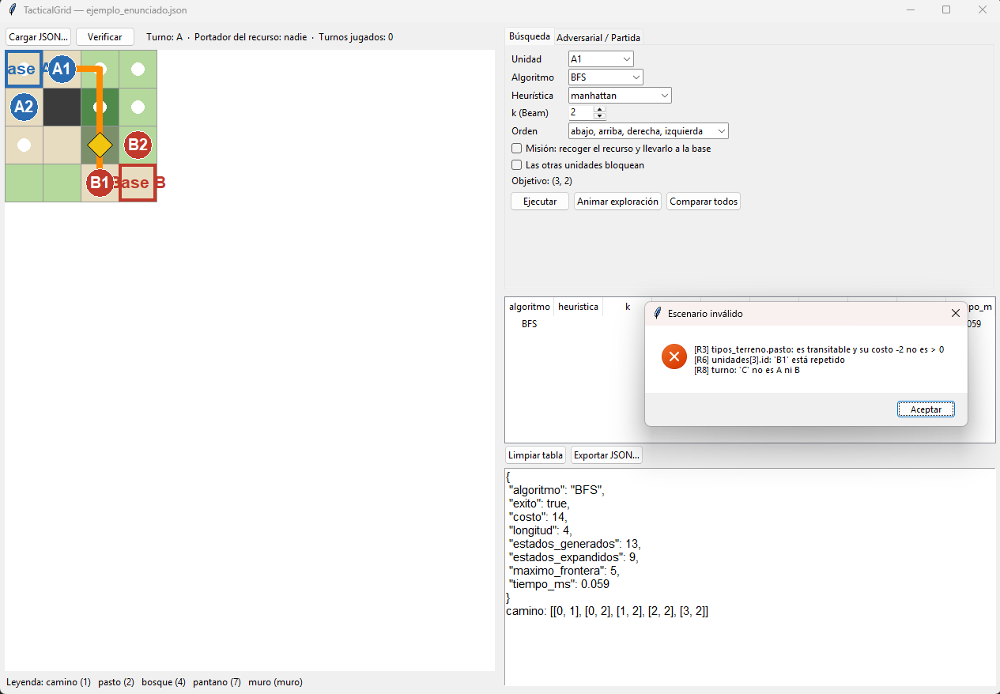
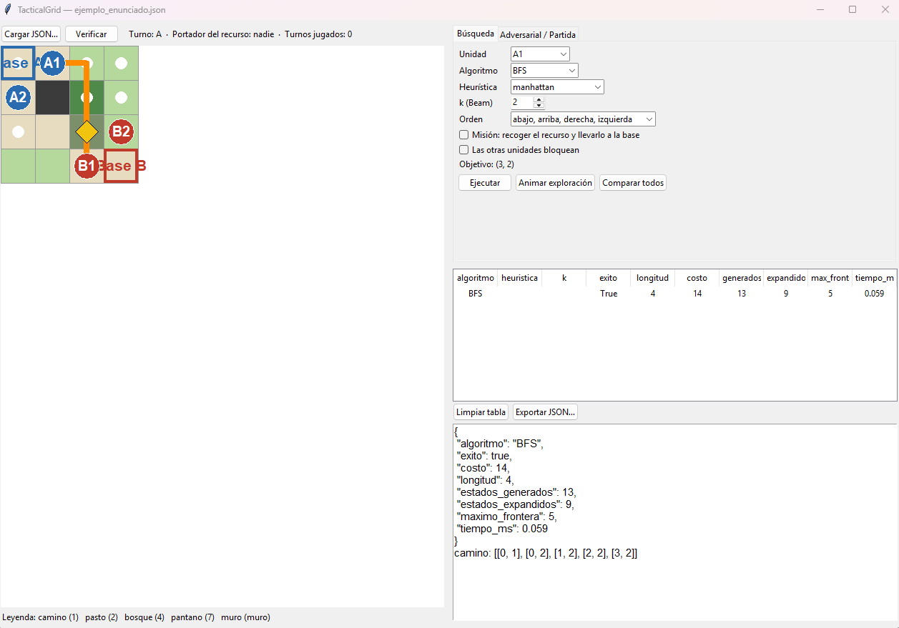
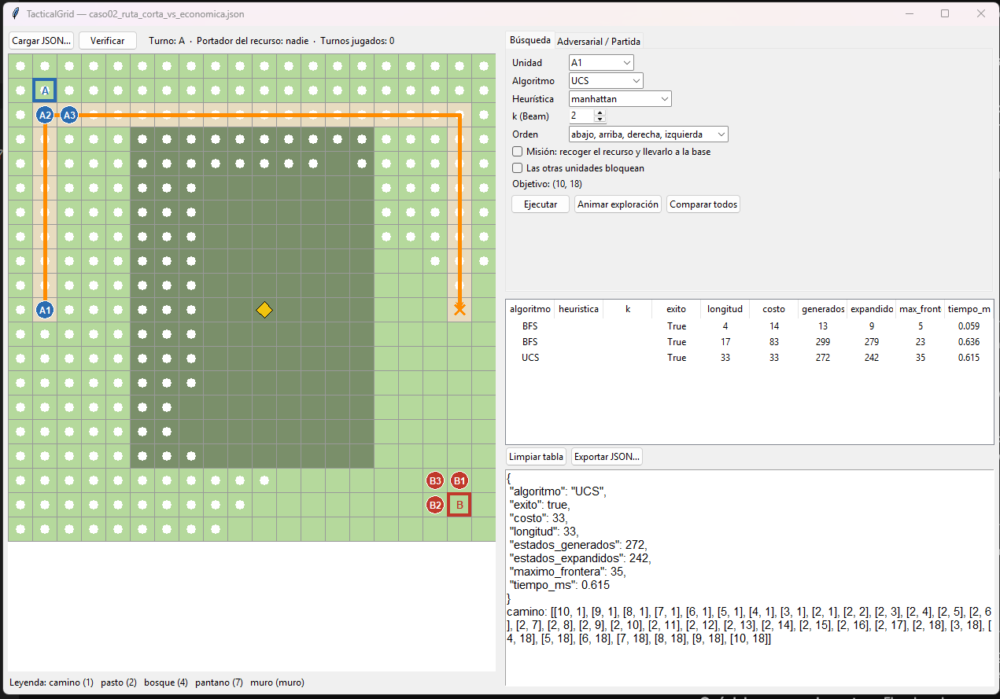
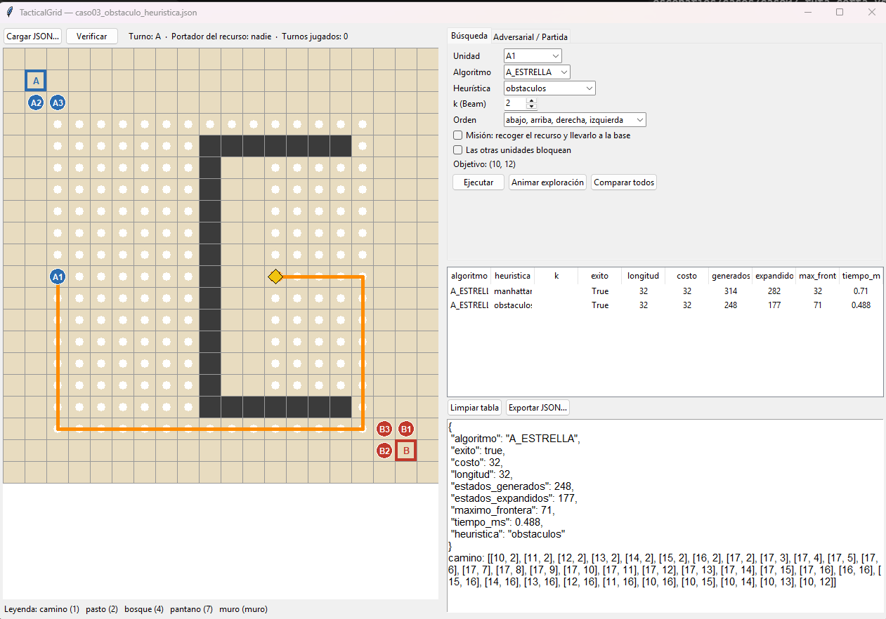
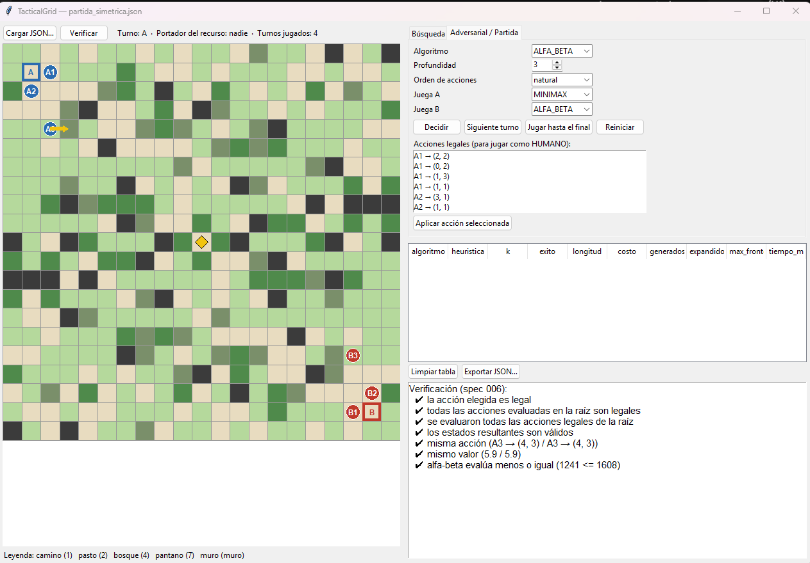

# Manual de usuario — TacticalGrid

**Proyecto 1 — Sistemas Inteligentes I**  
**Universidad de Caldas — Ingeniería de Sistemas y Computación**  
**Integrantes:** Daniel Quintero Hurtado y Juan David Ocampo González  
**Docente:** Jairo I. Vélez B.

---

## 1. Instalación

**Requisitos:** Python 3.11 o superior con `tkinter` (solo requerido para la interfaz gráfica). El núcleo del sistema utiliza únicamente la librería estándar de Python.

```bash
git clone git@github.com:danielqh1408/Proyecto1Inteligentes.git
cd Proyecto1Inteligentes
python3 -m venv .venv
source .venv/bin/activate            # Windows: .venv\Scripts\Activate.ps1
pip install -r requirements.txt      # instala pytest (y matplotlib opcional)
```

**macOS con Python de Homebrew:** la instalación por defecto no incluye `tkinter`. Opciones para habilitarlo:
- Instalar el paquete de Tk: `brew install python-tk@3.12`
- O crear el entorno virtual con el Python de `uv` (que ya incluye `tkinter`): `uv venv -p 3.11 .venv`

**Comprobar la instalación:**
```bash
pytest -q
```
Deben ejecutarse y pasar en verde todas las pruebas del arnés.

---

## 2. El escenario JSON

Toda la configuración del entorno y de las pruebas proviene del archivo JSON siguiendo el formato común del enunciado (`escenarios/ejemplo_enunciado.json` corresponde al ejemplo oficial del PDF). No existen mapas, posiciones ni costos quemados en el código.

Además de los campos obligatorios del contrato (`version`, `mapa`, `tipos_terreno`, `terreno`, `bases`, `recurso`, `unidades`, `turno`, `juego.portador_recurso` y `prueba`), el programa reconoce los siguientes campos opcionales:

| Campo | Para qué sirve | Valor por defecto |
|---|---|---|
| `juego.profundidad_maxima_minimax` | Profundidad límite de búsqueda para Minimax y Poda Alfa-Beta | `3` |
| `juego.max_turnos` | Límite máximo de turnos de la partida antes de declarar empate | `200` |
| `juego.orden_acciones` | Orden de evaluación de jugadas: `natural`, `inverso` o `heuristico` | `natural` |
| `juego.pesos_utilidad` | Pesos de evaluación, p. ej. `{"posesion": 20, "carrera": 3, "movilidad": 0.1}` | Valores base en `config.py` |
| `prueba.algoritmo` | `BFS`, `DFS`, `UCS`, `A_ESTRELLA`, `BEAM` (o `MINIMAX`, `ALFA_BETA`, `VORAZ`) | `BFS` / `ALFA_BETA` |
| `prueba.heuristica` | `manhattan`, `obstaculos`, `manhattan_promedio`, `cero` | `manhattan` |
| `prueba.profundidad` | Profundidad de la decisión; prevalece sobre juego.profundidad_maxima_minimax | configuración del juego |
| `prueba.k` | Ancho del haz ($k$) para Beam Search | `2` |
| `prueba.orden_movimientos` | Orden de expansión, p. ej. `["arriba", "abajo", "izquierda", "derecha"]` | `["abajo", "arriba", "derecha", "izquierda"]` |
| `prueba.mision` | `true`: la unidad debe recoger el recurso libre o llevar el que ya porta a su base; se rechaza si lo porta otra unidad | `false` |
| `prueba.unidades_bloquean` | `true`: las demás unidades actúan como obstáculos durante la búsqueda | `false` |

### Validación y carga atómica
Antes de aplicar cualquier escenario, el sistema valida las reglas de integridad (dimensiones consistentes, terrenos definidos en el catálogo, costos transitables $> 0$, posiciones dentro del mapa, ninguna unidad sobre obstáculos ni superpuesta, identificadores únicos, bandos/turno válidos y portador existente). Si el JSON contiene errores, el programa los reporta todos indicando código y campo, y conserva intacto el escenario previo. También valida los campos opcionales usados por la aplicación: objetivo, unidad, k, profundidad, órdenes, booleanos y pesos. Bases o recurso sobre un muro se admiten por el contrato y resultan inalcanzables.



---

## 3. Línea de comandos (CLI)

Todos los modos del sistema pueden ejecutarse desde la terminal mediante `python -m tacticalgrid`:

| Comando | Qué hace |
|---|---|
| `python -m tacticalgrid validar a.json b.json …` | Valida uno o varios escenarios JSON e informa si cumplen el contrato o lista sus errores |
| `python -m tacticalgrid ejecutar a.json` | Ejecuta automáticamente lo que indique `prueba.modo` (`busqueda`, `adversarial` o `partida`) y verifica la solución |
| `python -m tacticalgrid buscar a.json [--algoritmo X --heuristica H --k N --mision --orden … --objetivo f,c --verificar]` | Ejecuta una búsqueda puntual e imprime el resultado en el formato JSON del enunciado |
| `python -m tacticalgrid comparar a.json` | Imprime una tabla comparativa con BFS, DFS, UCS, A\* (2 heurísticas) y Beam Search ($k = 1, 2, 4, 8$) sobre el mismo escenario |
| `python -m tacticalgrid decidir a.json [--algoritmo MINIMAX\|ALFA_BETA\|VORAZ --profundidad N --orden O --verificar]` | Calcula la mejor acción para el bando en turno; si el estado es terminal devuelve acción None; informa métricas y valores/cotas raíz |
| `python -m tacticalgrid partida a.json --a ALFA_BETA --b VORAZ --profundidad 3` | Juega una partida completa por turnos entre dos agentes e imprime el historial y el ganador |
| `python -m tacticalgrid experimentos` | Regenera todos los archivos de evidencia reproducible en `resultados/` (10 casos mínimos + experimentos E1–E6) |
| `python -m tacticalgrid gui [a.json]` | Abre la interfaz gráfica interactiva (cargando opcionalmente el escenario indicado) |

---

## 4. Interfaz gráfica (GUI)

Para iniciar la interfaz gráfica ejecute:
```bash
python -m tacticalgrid gui escenarios/ejemplo_enunciado.json
```



Las capturas originales de esta sección ilustran la disposición de la interfaz. Las cifras y etiquetas antiguas no son evidencia de la revisión actual; los resultados reproducibles vigentes están en `resultados/`. La captura adversarial anterior se retira porque usaba el peso de posesión 50 en lugar de 20.

### 4.1 Barra superior y Mapa
- **Barra superior:**
  - **Cargar JSON…:** abre el selector de archivos para cargar cualquier escenario nuevo. Si el archivo es inválido, muestra la lista de errores sin perder el escenario actual. Una carga válida toma las opciones del JSON, restablece los valores omitidos y limpia la tabla de resultados.
  - **Verificar:** ejecuta el verificador independiente sobre el último resultado de búsqueda o decisión adversarial. Después de mover se descarta la decisión anterior y se verifica el estado actual.
  - **Indicadores de estado:** muestra en todo momento el turno actual (`A` o `B`), qué unidad porta el recurso (o si está libre) y el resumen del último resultado.
- **Mapa interactivo y Leyenda:**
  - Cada color representa un tipo de terreno y en la parte inferior se muestra automáticamente la leyenda con el nombre y el costo leídos del JSON.
  - **Gris oscuro:** obstáculo (celda no transitable).
  - **Bordes azul / rojo:** bases de los bandos A y B.
  - **Rombo amarillo:** recurso libre en el mapa.
  - **Círculos etiquetados:** unidades del bando A (azul) y del bando B (rojo) con su respectivo `id`.
  - **Borde dorado:** resalta la unidad que porta actualmente el recurso.
  - **Selección de objetivo con clic:** al hacer clic sobre cualquier celda del mapa se fija como coordenada objetivo para la búsqueda (marcada con una **✕ naranja**).

### 4.2 Pestaña Búsqueda
Permite configurar y ejecutar los algoritmos de búsqueda sobre las posiciones iniciales del JSON. Al buscar, la vista de partida se reinicia para coincidir con ese problema:
- **Controles:** selección de unidad de inicio, algoritmo (`BFS`, `DFS`, `UCS`, `A_ESTRELLA`, `BEAM`), heurística (`manhattan`, `obstaculos`, `manhattan_promedio`, `cero`), ancho del haz `k`, orden de movimientos y casillas para activar el modo **Misión** (recoger el recurso y llevarlo a la base) y **Las otras unidades bloquean**.
- **Ejecutar:** calcula la ruta, dibuja sobre el mapa los estados expandidos (puntos blancos) y el camino solución (línea naranja), y añade una fila a la tabla comparativa de métricas.
- **Animar exploración:** reproduce paso a paso el orden en que el algoritmo expandió los estados.
- **Comparar todos:** ejecuta de una sola vez BFS, DFS, UCS, A\* con ambas heurísticas y Beam Search ($k = 1, 2, 4, 8$) sobre el problema actual y agrega todas las filas a la tabla para compararlas directamente.





### 4.3 Pestaña Adversarial / Partida
Permite tanto analizar una decisión táctica puntual como simular partidas completas por turnos:
- **Decisión puntual (*Decidir*):**
  - Permite elegir el algoritmo (`MINIMAX`, `ALFA_BETA` o `VORAZ`), la profundidad máxima de búsqueda y el orden de generación de acciones (`natural`, `inverso` o `heuristico`).
  - Al pulsar **Decidir**, resalta en el mapa la acción recomendada con una **flecha amarilla** y muestra en el panel de detalle las métricas (`nodos_generados`, `nodos_evaluados`, `nodos_podados`, `profundidad_alcanzada`, `tiempo_ms`), las evaluaciones de ordenamiento y totales, los componentes del hijo inmediato elegido y el valor de cada acción en la raíz. En alfa-beta, las acciones no elegidas pueden mostrar cotas. El desglose del hijo no es el valor Minimax de una hoja.

Para reproducir el ejemplo actual: `python -m tacticalgrid decidir escenarios/casos/caso08_minimax_vs_alfabeta.json --profundidad 4 --verificar`. Resultado: A2 → (12, 6), valor −47; 427 hojas, 428 evaluaciones totales.

- **Simulación de Partida:**
  - **Juega A / Juega B:** permite asignar a cada bando `HUMANO`, `ALFA_BETA`, `MINIMAX` o `VORAZ`.
  - **Siguiente turno:** ejecuta un turno del bando activo.
  - **Jugar hasta el final:** avanza automáticamente los turnos hasta que un bando entregue el recurso en su base o se alcance la condición de empate.
  - **Modo HUMANO:** seleccione una de las acciones legales listadas en el panel y pulse **Aplicar acción seleccionada**.
  - **Reiniciar:** restaura el tablero al estado inicial definido en el JSON.



### 4.4 Tabla comparativa de métricas
Ubicada en la parte inferior, acumula los resultados de todas las ejecuciones realizadas (`algoritmo`, `exito`, `longitud`, `costo`, `generados`, `expandidos`, `frontera`, `tiempo_ms`) para facilitar el análisis comparativo. El detalle de una búsqueda y los CSV también separan tiempo del algoritmo, preparación de la heurística y tiempo total (sin cargar JSON ni dibujar). Incluye los botones **Limpiar tabla** y **Exportar JSON…** para guardar los resultados.

---

## 5. Ejemplos rápidos para pruebas y sustentación

1. **Ruta más corta en pasos vs. ruta más económica en costo (Caso 2):**
   ```bash
   python -m tacticalgrid comparar escenarios/casos/caso02_ruta_corta_vs_economica.json
   ```
   Permite verificar cómo `BFS` minimiza el número de movimientos mientras `UCS` y `A*` rodean el terreno costoso para minimizar el costo acumulado $g(n)$.

2. **Efecto de obstáculos en forma de U y dominancia heurística (Caso 3):**
   En la GUI, cargue `escenarios/casos/caso03_obstaculo_heuristica.json`, seleccione `A_ESTRELLA` y pulse **Animar exploración** primero con la heurística `manhattan` y luego con `obstaculos`. Observará que ambas encuentran el costo óptimo, pero `obstaculos` expande menos estados.

3. **Invariancia y ahorro de Poda Alfa-Beta frente a Minimax (Caso 8):**
   ```bash
   python -m tacticalgrid decidir escenarios/casos/caso08_minimax_vs_alfabeta.json --algoritmo MINIMAX --profundidad 3 --verificar
   python -m tacticalgrid decidir escenarios/casos/caso08_minimax_vs_alfabeta.json --algoritmo ALFA_BETA --profundidad 3 --verificar
   ```
   Comprueba que ambos algoritmos eligen exactamente la misma acción y el mismo valor Minimax, pero `ALFA_BETA` evalúa menos nodos al podar ramas con $\alpha \ge \beta$.

4. **Decisión táctica frente a adversario vs. comportamiento voraz (Caso 7):**
   ```bash
   python -m tacticalgrid decidir escenarios/casos/caso07_decision_adversarial.json --verificar
   ```
