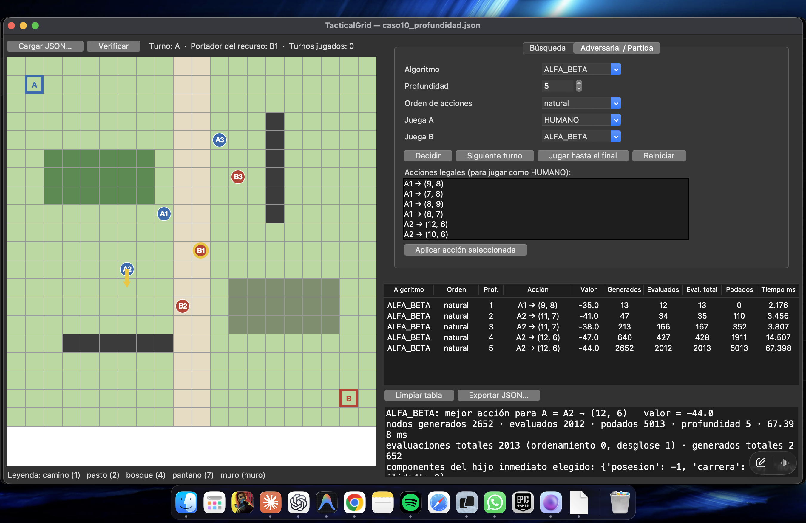

# Manual de usuario

**TacticalGrid · Proyecto 1 · Sistemas Inteligentes I**
Universidad de Caldas · Ingeniería de Sistemas y Computación
Daniel Quintero Hurtado · Juan David Ocampo González
Docente: Jairo I. Vélez B. · Edición de entrega: 21 de octubre de 2026

## 1. Preparación y ejecución

El programa requiere Python 3.11 o superior. El núcleo utiliza la librería estándar; la interfaz necesita Tkinter. Ejecute los comandos desde la raíz del repositorio, donde están `tacticalgrid/` y `escenarios/`.

```bash
git clone https://github.com/danielqh1408/Proyecto1Inteligentes.git
cd Proyecto1Inteligentes
python3 -m venv .venv
source .venv/bin/activate
pip install -r requirements.txt
python -m tkinter
python -m tacticalgrid gui
```

En Windows, active el entorno con `.venv\Scripts\Activate.ps1` desde PowerShell. `python -m tkinter` debe abrir una ventana de comprobación; puede cerrarla antes de iniciar TacticalGrid. En macOS, si su Python de Homebrew no incluye Tk, instale el paquete correspondiente a su versión de Python; por ejemplo, `python-tk@3.12` para Python 3.12. El equipo también verificó un entorno Python 3.11 de uv con Tk.

Para revisar la instalación completa, incluidas las comprobaciones documentales de entrega:

```bash
python -m pytest -o addopts='' -q
```

La revisión del 21 de octubre aprobó 288 pruebas con Tk disponible. Sin Tk, las cuatro pruebas gráficas se omiten; no debe interpretarse esa omisión como validación de la interfaz.

## 2. Abrir un escenario y reconocer el tablero

Pulse **Cargar JSON…** y seleccione un archivo de `escenarios/casos/`, el ejemplo oficial o un escenario externo. La carga válida actualiza los controles y limpia las comparaciones anteriores. La carga inválida muestra los errores y conserva el escenario previo.

El tablero usa coordenadas **(fila, columna)** desde cero. Los colores y costos aparecen en la leyenda. Las unidades azules pertenecen a A; las rojas, a B. Las bases están identificadas por letras y el portador tiene un borde dorado. El indicador superior muestra quién juega, quién lleva el recurso y cuántos turnos se han ejecutado.

Los terrenos y costos se obtienen del JSON. Los obstáculos no se pueden atravesar. La cruz naranja representa el objetivo de navegación seleccionado; no es el recurso. El recurso libre se representa con un rombo amarillo.

**Objetivo de la partida:** llevar el recurso a la base propia. Estar en la base sin recurso no produce victoria.

## 3. Buscar una ruta

Abra **Búsqueda**. Seleccione la unidad, el algoritmo y, cuando corresponda, la heurística y el ancho `k`. Conserve el objetivo cargado o selecciónelo haciendo clic en el tablero.

| Control | Uso |
|---|---|
| BFS | Busca mínimos movimientos; ignora costos al ordenar. |
| DFS | Profundiza por ramas; no garantiza mínimos movimientos ni costo. |
| UCS | Minimiza el costo acumulado. |
| A_ESTRELLA | Combina costo acumulado y estimación restante. |
| BEAM | Conserva hasta k candidatos para el siguiente nivel; puede perder soluciones. |
| Heurística | Manhattan, obstáculos, promedio experimental o cero. UCS no necesita elegir una. |
| Orden | Cambia el orden de generación de movimientos. |
| Misión | Recoger el recurso y llevarlo a la base; el estado incluye si lo transporta. |
| Las otras unidades bloquean | Trata sus posiciones iniciales como obstáculos estáticos. Por defecto se ignoran en navegación. |

Pulse **Ejecutar** para dibujar el camino y agregar una fila. **Animar exploración** muestra los estados expandidos progresivamente. **Comparar todos** agrega ejecuciones de BFS, DFS, UCS, A* y Beam. Los resultados se calculan desde las posiciones iniciales del JSON: ejecutar una búsqueda reinicia la vista de partida.

**Manhattan** ignora muros; **obstáculos** incorpora sus rodeos mediante BFS y costo mínimo. Ambas permiten A* óptimo en este modelo. `manhattan_promedio` es experimental y no garantiza optimalidad. En Beam, la interfaz usa criterio h: menor estimación restante primero.

Si aparece `exito = false`, no hay camino devuelto. En Beam esto puede ocurrir aunque exista una ruta, debido al descarte de alternativas. Costo cero junto a fracaso no significa que exista una solución gratuita.

## 4. Consultar decisiones y comparar profundidades

Abra **Adversarial / Partida**. Para una comparación controlada, mantenga el mismo estado y cambie una sola opción por vez.

| Control | Función |
|---|---|
| Algoritmo | Agente que se consulta al pulsar Decidir. |
| Profundidad | Número máximo de acciones individuales anticipadas. Profundidad 3 desde A significa A, B, A. |
| Orden de acciones | Natural, inverso o heurístico. Cambia el orden de exploración de las mismas acciones legales. |
| Decidir | Recomienda una acción y muestra una flecha; no mueve ninguna ficha. |
| Juega A / Juega B | Agentes que ejecutan los turnos de la partida. Son independientes del selector Algoritmo. |

Por ejemplo, con Algoritmo = ALFA_BETA y Juega A = Juega B = MINIMAX, **Decidir** consulta alfa-beta, pero **Siguiente turno** y **Jugar hasta el final** utilizan Minimax para ambos bandos.

El orden heurístico usa la evaluación de posesión, carrera y movilidad; no usa la heurística de obstáculos de A*. Intenta explorar primero las opciones favorables a quien juega y registra por separado las evaluaciones necesarias para ordenar.

### Comparación en la tabla

Cada pulsación de **Decidir** agrega algoritmo, orden, profundidad, acción, valor, generados, evaluados, evaluaciones totales, podados y tiempo. Cambiar de pestaña muestra la tabla correspondiente y conserva sus filas. **Limpiar tabla** y **Exportar JSON…** actúan sobre la tabla visible.

La tabla adversarial se limpia al mover, reiniciar o cargar otro escenario: evita mezclar decisiones de estados distintos. Para comparar profundidades 1 a 5, cambie el control y pulse Decidir cinco veces, sin avanzar turnos.



**Figura 1.** Captura real aportada por Juan durante el ensayo del 21 de octubre. Los tiempos corresponden a esa sesión y pueden diferir de los CSV. Las cifras de nodos, acciones y valores coinciden con el caso 10. Las capturas 01–07 conservadas en el repositorio son históricas y no se usan como evidencia numérica actual.

### Interpretar el resultado

El valor se expresa desde la perspectiva del bando que decide: mayor es mejor para ese bando. Un valor negativo no significa derrota segura ni una probabilidad de perder. El desglose muestra la evaluación del **hijo inmediato elegido**; el valor Minimax proviene del análisis hasta la profundidad indicada y puede ser distinto. En alfa-beta, los valores de acciones no elegidas pueden ser cotas, no sus valores exactos.

## 5. Jugar una partida

Seleccione quién controla A y B. **Siguiente turno** calcula y ejecuta una acción del bando activo. **Jugar hasta el final** repite el proceso hasta una victoria, el límite de turnos o un turno humano. Para HUMANO, seleccione una acción de la lista y pulse **Aplicar acción seleccionada**. **Reiniciar** vuelve al estado inicial y detiene una partida automática o animación pendiente.

Las reglas son iguales para ambos bandos:

- Cada turno permite una acción de una unidad propia.
- Se mueve en cuatro direcciones a una celda transitable y desocupada; no se entra en la base rival.
- Entrar en la casilla del recurso libre lo recoge.
- Una unidad adyacente al portador rival puede interceptarlo. El recurso vuelve a su origen; el antiguo portador vuelve a su posición inicial si está libre, y permanece donde estaba si está ocupada.
- Si no hay ninguna acción, el bando pasa. No hay eliminación de unidades.
- Gana quien entrega el recurso en su base. Sin ganador al alcanzar el límite, hay empate; el valor predeterminado es 200 turnos individuales.

Puede haber movimientos repetitivos: la evaluación limitada no penaliza explícitamente repetir tableros. El límite asegura que la partida termina; no garantiza que siempre haya ganador.

## 6. Verificar y leer métricas

Pulse **Verificar** después de Ejecutar o Decidir, antes de mover. Si ya se ejecutó un turno, se comprueba el estado actual, porque la recomendación anterior dejó de corresponder a ese estado.

| Resultado disponible | Comprobaciones |
|---|---|
| Camino | Inicio, vecindad, obstáculos, sucesores válidos, costo recalculado, longitud y objetivo. |
| Búsqueda fallida | Camino vacío; BFS confirma inalcanzabilidad salvo en Beam, que puede fallar por descarte. |
| Decisión | Legalidad y cobertura de las acciones de la raíz, acción elegida y validez de sus sucesores. Además se compara Minimax y alfa-beta con igual configuración. |
| Solo estado | Posiciones válidas, sin superposición, portador/recurso coherentes, turno y contador válidos. |

El verificador adversarial no vuelve a recorrer cada nodo interno del árbol. La generación y aplicación de acciones legales se comparte con los algoritmos y se comprueba con pruebas automáticas. Verificar una decisión profunda puede tardar más porque también ejecuta Minimax sin poda.

**Generados** son inserciones en la frontera de búsqueda, o estados creados en el árbol adversarial. **Expandidos** son estados cuyos sucesores se analizaron. **Evaluados** son hojas donde se calculó utilidad. **Podados** cuenta acciones hermanas omitidas en los cortes, no todos sus descendientes hipotéticos. **Frontera máxima** mide candidatos pendientes, no toda la memoria.

Longitud cuenta movimientos; costo suma las entradas a terrenos sin cobrar la posición inicial. Los tiempos de búsqueda separan algoritmo, preparación de la heurística y total en el detalle y los CSV. En adversarial, las evaluaciones totales incluyen hojas, ordenamiento y desglose. Los tiempos no son constantes del algoritmo.

## 7. Recorrido de los diez casos

Cargue el JSON correspondiente desde `escenarios/casos/`. Mantenga las demás opciones y el estado inicial al comparar.

| Caso | Prueba | Qué observar |
|---|---|---|
| 1 | BFS y DFS | 29 frente a 137 movimientos; estrategias de exploración distintas. |
| 2 | BFS y UCS | 17 pasos/costo 83 frente a 33 pasos/costo 33. |
| 3 | A* Manhattan y obstáculos | Costo 32; 282 frente a 177 expansiones. |
| 4 | UCS y A* con ambas heurísticas | Costo 64 en los tres; 332, 294 y 289 expansiones. |
| 5 | Beam Manhattan, k = 1, 2, 4, 8 | k = 1 falla; los otros encuentran costo 21. |
| 6 | UCS con Misión activada | Ida y regreso; 20 movimientos/costo 22, posiciones repetidas con distinto estado. |
| 7 | Minimax natural, profundidad 1 y 4 | A2 a (8,11) frente a (9,12); considerar respuestas cambia la acción. |
| 8 | Minimax y alfa-beta, profundidad 4, natural | Misma acción y valor -47; 20478 frente a 427 hojas. |
| 9 | Alfa-beta, profundidad 4, tres órdenes | Valor -47; comparar hojas, ordenamiento y totales. |
| 10 | Alfa-beta natural, profundidad 1–5 | Crecimiento de trabajo; cambian valores y algunas acciones. |

Los nombres completos de archivo y la evidencia están en `resultados/RESUMEN.md`. El caso 8 corresponde a `caso08_minimax_vs_alfabeta.json`; el caso 10, a `caso10_profundidad.json`.

## 8. JSON externo y terminal

El formato común incluye version, dimensiones, catálogo de terrenos, matriz, bases, recurso, unidades, turno y juego.portador_recurso. **prueba es opcional.** Admite los modos busqueda, adversarial y partida. El ejemplo oficial 4×4 se acepta; los diez escenarios propios son 20×20 y tienen tres unidades por bando.

Antes de reemplazar el escenario se validan dimensiones, terrenos, costos positivos finitos, posiciones, unidades no superpuestas, identificadores, bandos, turno y portador. También se validan las opciones de prueba que utiliza la aplicación. Bases o recurso sobre un muro se admiten según el contrato y se tratan como inalcanzables.

| Opción adicional | Valor predeterminado |
|---|---|
| juego.profundidad_maxima_minimax | 3 |
| juego.max_turnos | 200 |
| juego.orden_acciones | natural |
| juego.pesos_utilidad | posesion: 20, carrera: 3, movilidad: 0.1 |
| prueba.k | 2 |
| prueba.heuristica | manhattan |
| prueba.mision / prueba.unidades_bloquean | false / false |

`prueba.profundidad` prevalece sobre la profundidad de juego. Los argumentos explícitos de CLI/GUI prevalecen sobre el JSON. En la terminal puede usar:

```bash
python -m tacticalgrid validar escenarios/ejemplo_enunciado.json
python -m tacticalgrid ejecutar escenarios/ejemplo_enunciado.json
python -m tacticalgrid buscar escenarios/casos/caso02_ruta_corta_vs_economica.json --algoritmo UCS --verificar
python -m tacticalgrid decidir escenarios/casos/caso08_minimax_vs_alfabeta.json --algoritmo ALFA_BETA --profundidad 4 --verificar
python -m tacticalgrid experimentos
```

Para otras opciones: `python -m tacticalgrid --help` y la ayuda del subcomando. Los CSV E1–E6 se regeneran junto al resumen. Mantenga copias de los JSON antes de cambiar costos para una demostración.

## 9. Problemas frecuentes

| Situación | Qué hacer |
|---|---|
| Falta tkinter | Use un Python con Tk; compruebe primero `python -m tkinter`. |
| Un JSON es rechazado | Corrija los campos que indica el mensaje; el tablero anterior permanece intacto. |
| No aparece la tabla nueva | Cierre y vuelva a ejecutar la aplicación desde la versión actual del repositorio. |
| Decidir no mueve | Es una consulta. Para ejecutar use Siguiente turno o una acción humana. |
| Un agente repite movimientos | Puede ocurrir con horizonte limitado; el máximo de turnos termina en empate. |
| Beam falla | No demuestra que sea inalcanzable; compare con BFS/UCS y varíe k. |
| Misma posición aparece dos veces | En Misión puede ser sin recurso y con recurso: son estados distintos. |

Manual actualizado con apoyo de Codex. La trazabilidad de herramientas, pruebas y revisión humana está en `docs/USO_IA.md`.
